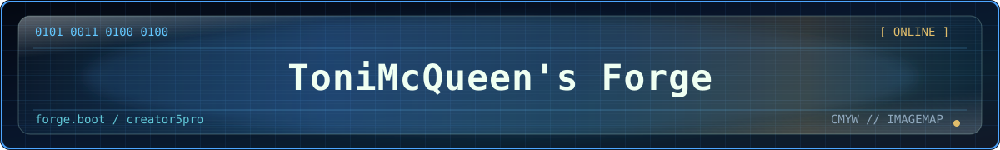

# ToniMcQueen-forge

<p align="center">
  
</p>

> **Latest tagged source:** [`v20261018d-creator5pro-local-fullcolour`](https://github.com/mcqueentrading/ToniMcQueen-forge/tree/v20261018d-creator5pro-local-fullcolour)<br>
> **Release archive:** [GitHub Releases](https://github.com/mcqueentrading/ToniMcQueen-forge/releases)<br>
> **Current development branch:** `creator5pro-local-fullcolour-tuning`

```text
01010100 01101111 01101110 01101001 01001101 01100011 01010001 01110101 01100101 01100101 01101110

> wake up, Creator 5 Pro
> the stock firmware has you
> follow the white filament
```

**ToniMcQueen-forge** is our local FlashForge Creator 5 Pro firmware fork.
It is built for our workshop workflow: full-colour ImageMap printing, safer
toolchange behavior, snapshot timelapse evidence, Orca profile control, and
repeatable calibration.

This is not upstream Reforge. It is our fork, for our machine. It exists
because the Reforge/Klipper4FlashForge developers did the hard base-port work:
FlashForge update packaging, Klipper/Moonraker/Mainsail/HelixScreen integration,
toolchanger support, installer safety, and the Creator 5 documentation base.
Thank you to the Reforge developers and the Creator 5 modding community.

## Visual Guide

| Printer status | Bed mesh | Calibration |
|---|---|---|
|  |  |  |

These are real project screenshots and calibration evidence from the fork,
not promotional renders.

```text
[ operator ] ToniMcQueen
[ machine  ] FlashForge Creator 5 Pro
[ branch   ] creator5pro-local-fullcolour-tuning
[ goal     ] reliable CMYW / ImageMap / toolchange workflow
[ rule     ] physical printer evidence beats screenshots
```

## What This Fork Adds

- Local Creator 5 Pro macros for print lifecycle, preflight, purge, resume, and cancel behavior.
- A standalone `REFORGE_PREFLIGHT` macro for purge/check workflows without silently starting a print.
- Safer `START_PRINT` mesh handling: it does not blindly clear/load meshes unless requested.
- Full-colour purge/preflight profile work for debugging CMYW tool reliability.
- Toolchange hardening around dock, grab, release, load, purge, and runout sensor windows.
- Purge-tower transition fix: restore XY after `T<n>` so the first purge extrusion does not run from the dock.
- Runout and motion/clog sensor policy so sensors are disarmed only during risky tool handling paths.
- Snapshot timelapse plumbing for per-print photo evidence and later AI review.
- Timelapse package patching so raw frames can be zipped and cleaned instead of rendering costly video.
- Dual-camera support kept in the fork instead of dropping the second feed.
- Moonraker/camera/API hardening notes and config work for weaker printer-board resources.
- Chamber heater, chamber fan, aux cooling, and outside-air intake policy for PLA versus ABS/ASA/nylon.
- Fan-control planning for the Creator 5 Pro airflow problem where chamber heat and aux cooling fight each other.
- Dropbear/SSH installer handling so SSH access survives cleanly instead of losing host keys or breaking login paths.
- Boot-screen branding support for `ToniMcQueen's Forge`.
- Orca/ImageMap printer, process, and CMYW filament profiles.
- G-code arc fitting test plan for future slicer work.
- Static tests for the behavior we care about keeping fixed.
- Optional Tailscale userspace-networking package for remote access without
  requiring `/dev/net/tun`; disabled until the owner explicitly logs in.

## Full-Colour Print Contract

The CMYW ImageMap profiles now use a single startup owner:

```text
Orca/ImageMap G-code -> START_PRINT -> tool preparation -> mesh policy -> print
```

`REFORGE_PREFLIGHT` is deliberately excluded from sliced start G-code. It is a
manual diagnostic command for purging and checking tools. Calling it from a
print can collide with the job state because Moonraker marks the job as
`printing` before Klipper evaluates the start block.

The profiles use these mutually exclusive mesh modes:

| Mode | Start parameters | Behaviour |
|---|---|---|
| Active mesh | `LEVEL=0` | Keep the currently active mesh |
| Full mesh | `LEVEL=1` | Probe the complete bed once |
| Adaptive mesh | `ADAPTIVE=1 ADAPTIVE_MARGIN=5` | Probe the sliced-object area once |
| Saved mesh | `MESH=<profile>` | Load one named saved mesh |

Do not combine `MESH` with `LEVEL=1` or `ADAPTIVE=1`. The macro rejects those
combinations rather than probing twice or silently replacing a known mesh.
Keep `[exclude_object]` enabled in the slicer when using adaptive probing so
Klipper receives the object bounds.

The start path sends `SET_LED LED=chamber_led WHITE=1.0 TRANSMIT=1` and enables
snapshot-only timelapse capture. The explicit transmit flag is required by the
current Creator 5 LED path. If the physical LED still does not respond, treat
that as a separate hardware/output-pin diagnostic; do not add another
competing start macro.

## Profile Import And Validation

Import the JSON files from
`local/creator5pro-orca-imagemap-profiles/` into OrcaSlicer-ImageMap, then
restart the slicer or reload the machine presets. Before uploading a new job:

1. Confirm the generated start block contains exactly one `START_PRINT`.
2. Confirm it does not contain `REFORGE_PREFLIGHT` as a start command.
3. Confirm the intended mesh mode is present and no conflicting mode is set.
4. Preview layer 0 and inspect the first tool, prime path, and purge tower.
5. Run a monitored first layer after any nozzle, bed, offset, or profile change.

The repository profiles are versioned presets, not proof that the live printer
has identical offsets, mesh data, or physical LED behaviour.

## Firmware Boundary

This fork is a userspace and configuration fork. The normal slim installer
does **not** replace the FlashForge kernel, root filesystem, control package,
or MCU firmware. It keeps the stock hardware layer in place and installs our
Klipper, Moonraker, macros, services, profiles, and diagnostics on top.

FlashForge reports several independent version numbers. Do not treat these as
interchangeable:

```text
software package   1.9.x
kernel package     2.0.x
control package    1.2.x
Linux kernel       separate runtime release
```

The archived factory log records Software `1.9.7`, Kernel `2.0.5`, and
Control `1.2.9`; it also records the official `kernel-2.0.7` update and its
rollback warning. That evidence is kept locally in the printer backup, not
bundled into this repository. The fork does not attempt to downgrade or
upgrade that kernel component.

## Latest Installer

Download the `Creator5Pro` installer from the assets on the
[`v20261018b-creator5pro-local-fullcolour` release](https://github.com/mcqueentrading/ToniMcQueen-forge/releases/tag/v20261018b-creator5pro-local-fullcolour).
This release includes the purge-tower transition fix and remains a slim
userspace/configuration update: it does not reflash the stock kernel or MCU.

After installing it, reboot the printer or restart Klipper so the updated
`[ff_toolchange]` configuration is loaded. Reinstallation is required for an
existing printer to receive `restore_axis: xy`; no kernel downgrade or base
firmware reflash is needed.

## Changed Areas

```text
[ macros       ] START_PRINT, CANCEL_PRINT, RESUME, REFORGE_PREFLIGHT
[ toolchange   ] dock/release/grab paths, fast departure, parked tool state
[ sensors      ] filament switch + motion/clog sensor arming policy
[ timelapse    ] snapshot trigger, frame archive cleanup, no printer-side video render
[ cameras      ] preserve two camera feeds in the fork
[ airflow      ] chamber heater, recirculation, aux fan, outside-air cooling policy
[ ssh/dropbear ] installer-side SSH persistence and safer update handling
[ tailscale    ] optional userspace-networking client, no baked auth keys
[ boot         ] ToniMcQueen's Forge boot-screen branding
[ slicer       ] local Orca/ImageMap profiles, CMYW filament profiles, snapshot profiles
[ qa           ] static tests for lifecycle, timelapse, toolchange, webcam/fan, arcs, installer
```

The current toolchange implementation applies each calibrated nozzle-to-
station Z gap as part of the mounted-tool frame, while keeping thermal, bed,
and first-layer corrections as print-scoped terms. This distinction is
important: combining those terms incorrectly can drive a nozzle into the bed
or leave it printing several millimetres above the bed. The implementation
also refreshes offsets after Klipper becomes ready and before a tool-change
frame is applied.

This is a practical fork, not a clean-room rewrite. The point is to capture
the things we changed while tuning a real Creator 5 Pro, then make those
changes reproducible instead of leaving them as one-off live-printer edits.

## Matrix Map

```text
printer evidence pipeline
  print-id -> snapshot frames -> zip archive -> catalog metadata -> review

full-colour pipeline
  ImageMap calibration -> CMYW profile -> purge tuning -> texture print -> compare photos

firmware pipeline
  macro change -> package build -> static QA -> USB install -> hardware validation
```

Useful paths:

| Path | Purpose |
|---|---|
| `docs/local-fullcolour-fork-change-inventory.md` | Inventory of local fork changes |
| `docs/creator5pro-local-fullcolour-roadmap.md` | Roadmap for full-colour, evidence, and slicer work |
| `docs/notes/54-api-and-preflight-hardening.md` | API, preflight, Moonraker, and resource notes |
| `docs/notes/55-filament-motion-sensor-calibration.md` | Runout and motion sensor diagnostic plan |
| `docs/notes/56-upstream-and-c5-modding-review.md` | Upstream and Creator 5 modding review |
| `docs/notes/57-chamber-airflow-policy.md` | Chamber heat versus aux fan policy |
| `docs/notes/58-gcode-arcs-test-plan.md` | G2/G3 arc fitting plan |
| `docs/tailscale-remote-access.md` | Optional Tailscale/Headscale remote-access setup |
| `local/creator5pro-orca-imagemap-profiles/` | Local Orca/ImageMap profiles |

## Remote Access Quick Start

Tailscale is installed but disabled until the owner enables it. The installer
does not ship Wi-Fi passwords, Tailscale auth keys, or tailnet state.

After flashing, SSH to the printer and run:

```bash
toniforge-tailscale-enable
toniforge-tailscale up --accept-dns=false --hostname=tonimcqueen-forge
toniforge-tailscale status
```

If an older install does not expose those commands on `PATH`, use:

```bash
/usr/data/anvil/bin/toniforge-tailscale-enable
/usr/data/anvil/bin/toniforge-tailscale up --accept-dns=false --hostname=tonimcqueen-forge
/usr/data/anvil/bin/toniforge-tailscale status
```

For Headscale:

```bash
toniforge-tailscale up --login-server=https://HEADSCALE.example --accept-dns=false --hostname=tonimcqueen-forge
```

The `up` command prints a login URL. Open that URL on an admin machine and
approve the printer. State is kept in `/usr/data/anvil-data/tailscale/`.

## Build

Fetch pinned source assets:

```bash
./bin/fetch-assets.sh --all
```

Build packages:

```bash
make packages
```

Run static QA:

```bash
make qa-static
```

Known-good local result:

```text
375 passed
```

Useful host checks before committing:

```bash
python3 -m pyflakes qa/static
git diff --check
```

The profile files under `local/creator5pro-orca-imagemap-profiles/` are local
Orca/ImageMap presets, not proof that a particular live printer has the same
settings. Validate the generated G-code in Preview and run a monitored first
layer after any profile, mesh, nozzle, or tool-offset change.

## Flashing Rules

```text
there is no spoon
there is a heater
there is a bed that can be scratched
there is no substitute for watching first layer
```

- Build for `Creator5Pro`, not plain `Creator5`.
- Keep stock FlashForge recovery firmware available.
- Do not trust old Z offset after firmware or macro changes.
- Rehome, relevel, check Z offset, purge all needed tools, and inspect first layer.
- Do not install live-printer experiments unless the same behavior exists in the fork installer.
- Do not leave the printer unattended during new macro/toolchange testing.

## Remote

```text
https://github.com/mcqueentrading/ToniMcQueen-forge
```

Current working branch:

```text
creator5pro-local-fullcolour-tuning
```

## Credits

This fork is based on the Reforge/Klipper4FlashForge Creator 5 firmware work:

```text
https://github.com/Klipper4FlashForge/firmware
```

Special thanks to the Reforge developers for making the Creator 5/Creator 5 Pro
Klipper firmware path possible in the first place. This fork would not exist
without their installer, packaging, recovery, Klipper, Moonraker, Mainsail,
HelixScreen, toolchanger, and documentation work.

Thanks also to Klipper, Moonraker, Mainsail, HelixScreen, OpenCreator, and the
Creator 5 modding community for the ecosystem this local workshop branch builds
on. ToniMcQueen-forge is our experimental local branch and not an upstream
support channel.
